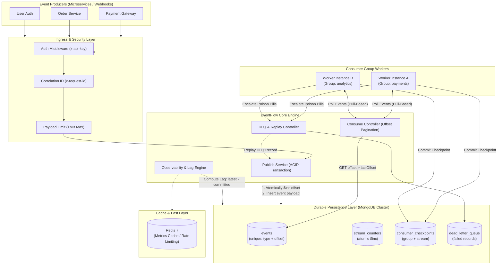
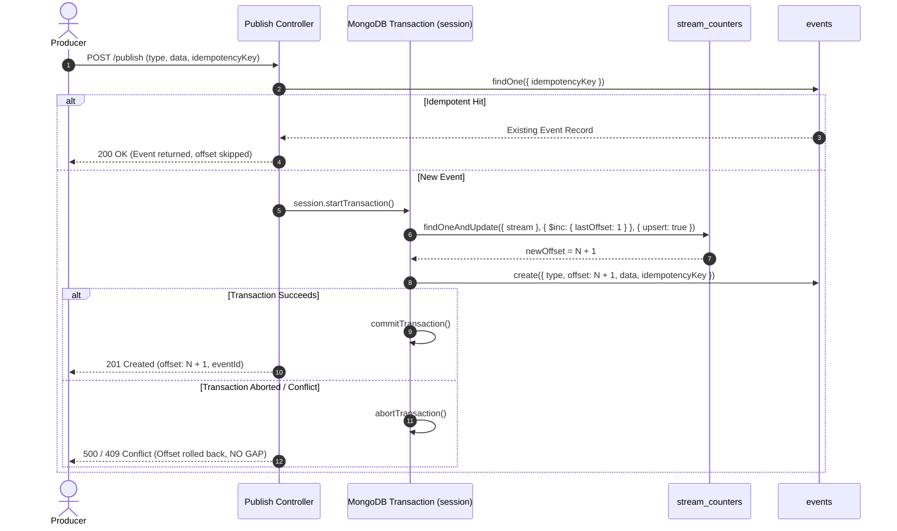
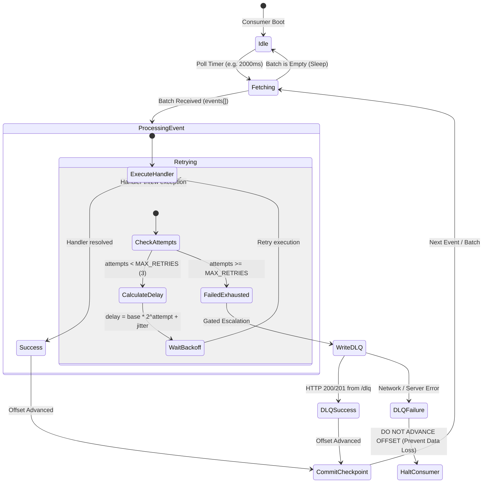
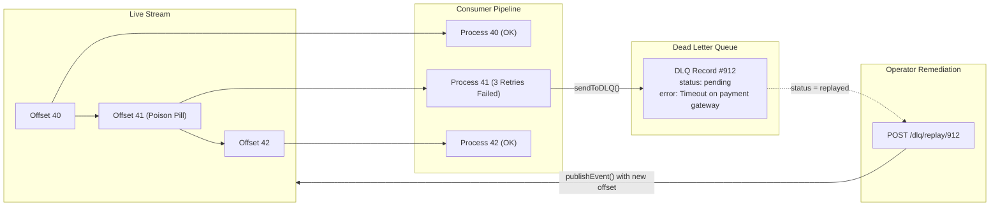
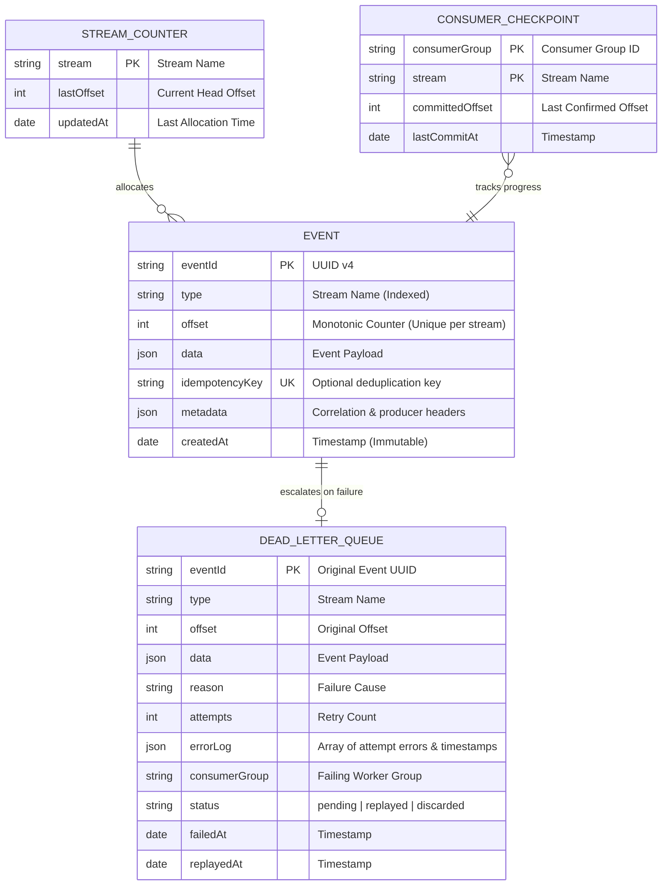

# ⚡ EventFlow — Production-Grade Event Streaming Engine

> An offset-ordered, append-only distributed event log with transactional offset allocation, durable consumer checkpoints, exponential backoff retries, and dead-letter queue (DLQ) recovery.

[](https://github.com/sahil/eventflow/actions)
[](https://nodejs.org/)
[](LICENSE)

---

## 📑 Table of Contents
1. [System Architecture Overview](#-system-architecture-overview)
2. [Distributed System Design & Engineering Deep Dive](#-distributed-system-design--engineering-deep-dive)
   - [1. Transactional Offset Allocation (Solving the Split-Brain Bug)](#1-transactional-offset-allocation-solving-the-split-brain-bug)
   - [2. Consumer State Machine & Durable Checkpointing](#2-consumer-state-machine--durable-checkpointing)
   - [3. Dead-Letter Queue (DLQ) & Non-Blocking Replay](#3-dead-letter-queue-dlq--non-blocking-replay)
   - [4. CAP Theorem & Consistency Model](#4-cap-theorem--consistency-model)
   - [5. Failure Mode & Effects Analysis (FMEA)](#5-failure-mode--effects-analysis-fmea)
3. [Data Architecture & Schema Design](#-data-architecture--schema-design)
4. [Defect Register & Production Hardening](#-defect-register--production-hardening)
5. [API Specification & Protocols](#-api-specification--protocols)
6. [Operational Runbook & Deployment](#-operational-runbook--deployment)
7. [Verification & Automated Test Suite](#-verification--automated-test-suite)

---

## 🏛️ System Architecture Overview

EventFlow is engineered to provide **per-stream total order guarantees**, **at-least-once delivery**, and **idempotent event publishing**.



---

## 🔬 Distributed System Design & Engineering Deep Dive

### 1. Transactional Offset Allocation (Solving the Split-Brain Bug)

#### The Problem in the Prototype (D-01)
In the initial prototype, offsets were allocated using Redis `INCR offset:{type}`, followed by an independent `MongoDB.create()` operation. 

```
[Producer] ──► Redis INCR (Offset = 5 allocated)
                     │
                     ▼
          MongoDB Insert FAILS (network blip, disk full, validator)
                     │
                     ▼
Permanent sequence gap (Offset 5 is burned; next publish gets Offset 6)
```
This broke stream invariants:
1. **Permanent Gaps**: Consumers expecting sequential logs `[1, 2, 3, 4, 5, 6]` stalled or reported inaccurate consumer lag.
2. **Race-Condition Reordering**: Concurrent publishers could obtain offsets out-of-order if publisher B finished inserting before publisher A.

#### The Production-Grade Solution: Atomic MongoDB Transactions
In EventFlow, the stream counter document and the event document are co-located in MongoDB and updated within a **single ACID transaction** (`session.withTransaction`):



---

### 2. Consumer State Machine & Durable Checkpointing

EventFlow implements a **pull-based consumption model** with at-least-once delivery guarantees. Consumers pull events in batches using offset pagination (`offset > lastOffset`), process them sequentially, and commit progress durably.



#### Key Guarantees:
- **Durable Checkpoints**: Offsets are stored in the `consumer_checkpoints` collection (`consumerGroup`, `stream`, `committedOffset`). Even on worker restart, execution resumes from the exact committed position.
- **Poison-Pill Isolation**: A message that crashes consumer business logic is safely routed to the Dead-Letter Queue after 3 exponential backoff attempts, preventing it from indefinitely blocking the stream.
- **DLQ-Gated Progress**: If the DLQ endpoint is unreachable or fails, the consumer halts and will not advance its checkpoint. **No event is ever silently dropped.**

---

### 3. Dead-Letter Queue (DLQ) & Non-Blocking Replay

When unprocessable messages are moved to the DLQ, they do not stall other healthy events. Once the underlying issue (e.g. downstream service outage, schema bug) is resolved, operators can trigger non-blocking replays.



---

### 4. CAP Theorem & Consistency Model

| Property | EventFlow Classification | Architectural Rationale |
|---|---|---|
| **CAP Classification** | **CP** (Consistency & Partition Tolerance) | Under network partition, EventFlow will reject publish requests rather than corrupt stream ordering or issue duplicate/divergent offsets. |
| **Write Consistency** | **Linearizable** | Monotonic offset allocation per stream guarantees a total order across all producers. |
| **Read Consistency** | **Read-After-Write (Causal)** | Offsets are immediately queryable via `$gt` offset scans once the transaction commits. |
| **Delivery Guarantee** | **At-Least-Once** | Consumers acknowledge messages by persisting checkpoints after processing. Crashes mid-processing result in re-delivery. Producers use `idempotencyKey` for deduplication. |

---

### 5. Failure Mode & Effects Analysis (FMEA)

| Failure Scenario | System Impact | Mitigation / Recovery Mechanism |
|---|---|---|
| **Producer network timeout during publish** | Producer cannot tell if event was written | Producer retries with identical `idempotencyKey`. EventFlow returns existing record with original offset; no duplicates created. |
| **MongoDB primary node failure mid-transaction** | Offset increment and event write abort together | Session rolls back automatically. No counter increment is persisted, preventing offset gaps. |
| **Consumer worker crashes during processing** | Checkpoint not committed for in-flight event | On restart, worker loads last committed offset from `consumer_checkpoints` and re-processes from that point. |
| **DLQ API outage during poison-pill handling** | Consumer cannot persist failed event to DLQ | Consumer pauses, sleeps with backoff, and halts checkpoint progression. Prevents message loss. |
| **Redis cluster restart / flush** | Cached metrics temporarily cleared | All metrics are derived from MongoDB as the single source of truth. Zero data loss. |

---

## 🗄️ Data Architecture & Schema Design



### Database Indexes

| Collection | Index Fields | Properties | Purpose |
|---|---|---|---|
| `events` | `{ type: 1, offset: 1 }` | `unique: true` | Enforces no duplicate offsets per stream; accelerates `$gt` range scans. |
| `events` | `{ idempotencyKey: 1 }` | `unique: true, sparse: true` | Instant deduplication lookup for producer retries. |
| `stream_counters` | `{ stream: 1 }` | `unique: true` | Fast atomic `$inc` updates during publishing. |
| `consumer_checkpoints` | `{ consumerGroup: 1, stream: 1 }` | `unique: true` | Fast checkpoint reads/upserts per group. |
| `dead_letter_queue` | `{ eventId: 1, consumerGroup: 1 }` | `unique: true` | Prevents duplicate DLQ logging for the same event and consumer. |
| `dead_letter_queue` | `{ type: 1, status: 1 }` | Non-unique | Fast filtering of unresolved DLQ events. |

---

## 🛠️ Defect Register & Production Hardening

EventFlow underwent a comprehensive architectural audit to eliminate prototype flaws:

| Bug ID | Severity | Root Cause in Prototype | Production Hardened Fix |
|---|---|---|---|
| **D-01** | 🔴 Critical | Redis `INCR` separated from MongoDB `create()`. Network drops created permanent sequence gaps. | Moved offset counter into MongoDB within a multi-document ACID transaction. |
| **D-02** | 🔴 Critical | `flushAll()` was invoked on Redis connection, wiping counters and resetting offsets to 1. | Removed `flushAll()`. Storage is durable; Redis is non-authoritative. |
| **D-03** | 🔴 Critical | Hardcoded placeholders (`"mongoURL"`, `host: 'redis'`, `port: xyz`). | Created centralized `config/index.js` with fail-fast startup validation. |
| **D-04** | 🟠 High | Consumer progress kept in volatile memory (`let lastOffset = 1`). Restarts re-processed all events. | Implemented durable MongoDB checkpoints (`consumer_checkpoints`). |
| **D-05** | 🟠 High | Consumer advanced offset even if `/dlq` HTTP call errored, permanently dropping failed events. | Gated offset advancement strictly on confirmed DLQ write. |
| **D-06** | 🟠 High | Consumer read `response.data` instead of `response.data.events`, causing it to sleep perpetually. | Fixed response parsing to extract `events` array and `nextOffset`. |
| **D-07** | 🟡 Medium | Polling initialized at `offset: 1` with query `offset > 1`, silently dropping offset 1. | Initialized checkpoints to `offset: 0` to consume from the stream head. |
| **D-09** | 🟡 Medium | Compound index on `(type, offset)` was non-unique. | Enforced database-level `{ unique: true }` constraint. |
| **D-11** | 🟡 Medium | Metrics and lag derived from volatile Redis keys. | Metrics calculated directly from MongoDB stream counters and checkpoints. |
| **D-14** | 🟢 Low | Zero authentication or access control on ingestion and DLQ endpoints. | Added API key authentication middleware (`x-api-key` / `Bearer` tokens). |

---

## 📖 API Specification & Protocols

### 1. Publish Event
`POST /publish`

Appends an event to the stream with a monotonically increasing offset.

```bash
curl -X POST http://localhost:3000/publish \
  -H "Content-Type: application/json" \
  -H "x-api-key: your-api-key" \
  -d '{
    "type": "payment.authorized",
    "data": {
      "transactionId": "txn_892182",
      "amount": 149.50,
      "currency": "USD"
    },
    "idempotencyKey": "req_unique_001",
    "metadata": {
      "correlationId": "corr_abc_123",
      "producerId": "checkout_svc"
    }
  }'
```

**Response (201 Created):**
```json
{
  "message": "Event published",
  "event": {
    "eventId": "a1b2c3d4-e5f6-7890-abcd-ef1234567890",
    "type": "payment.authorized",
    "offset": 105,
    "idempotencyKey": "req_unique_001",
    "data": {
      "transactionId": "txn_892182",
      "amount": 149.5,
      "currency": "USD"
    },
    "metadata": {
      "correlationId": "corr_abc_123",
      "producerId": "checkout_svc",
      "schemaVersion": 1
    },
    "createdAt": "2026-10-25T01:30:00.000Z"
  }
}
```

---

### 2. Consume Events
`GET /consume`

Fetches a batch of events starting strictly after the specified `offset`.

```bash
curl "http://localhost:3000/consume?type=payment.authorized&offset=100&limit=50" \
  -H "x-api-key: your-api-key"
```

**Response (200 OK):**
```json
{
  "events": [
    {
      "eventId": "a1b2c3d4-e5f6-7890-abcd-ef1234567890",
      "type": "payment.authorized",
      "offset": 101,
      "data": { "transactionId": "txn_892182", "amount": 149.5 },
      "createdAt": "2026-10-25T01:30:00.000Z"
    }
  ],
  "nextOffset": 101,
  "count": 1
}
```

---

### 3. Checkpoint Management & Replay
`GET /checkpoints`, `POST /checkpoints`

Allows inspection of consumer group lag and manual offset rewind for historical event replay.

```bash
# Rewind consumer group to offset 0 (Full Replay)
curl -X POST http://localhost:3000/checkpoints \
  -H "Content-Type: application/json" \
  -H "x-api-key: your-api-key" \
  -d '{
    "consumerGroup": "payment-processor",
    "stream": "payment.authorized",
    "committedOffset": 0
  }'
```

---

### 4. Dead-Letter Queue & Replay
`GET /dlq`, `POST /dlq/replay/:id`

```bash
# Inspect pending poison pills
curl "http://localhost:3000/dlq?type=payment.authorized&status=pending" \
  -H "x-api-key: your-api-key"

# Replay a resolved DLQ record back into the stream
curl -X POST http://localhost:3000/dlq/replay/671ad29b128f74e92b812f11 \
  -H "x-api-key: your-api-key"
```

---

### 5. Stream Metrics & Consumer Lag
`GET /metrics?type=payment.authorized`

Calculates live stream metrics and consumer lag across all consumer groups:

```json
{
  "stream": "payment.authorized",
  "totalEvents": 500,
  "failedEvents": 2,
  "latestOffset": 500,
  "consumerOffset": 498,
  "consumerLag": 2,
  "consumerGroups": [
    {
      "consumerGroup": "payment-processor",
      "committedOffset": 498,
      "consumerLag": 2,
      "lastCommitAt": "2026-10-25T01:34:00.000Z"
    }
  ]
}
```

---

### 6. Health & Readiness Probe
`GET /health` (Public endpoint)

```json
{
  "status": "healthy",
  "uptime": 1420.5,
  "timestamp": "2026-10-25T01:35:00.000Z",
  "dependencies": {
    "mongodb": "connected",
    "redis": "connected"
  }
}
```

---

## 🚀 Operational Runbook & Deployment

### Run with Docker Compose

EventFlow includes a production-ready Docker Compose environment that provisions a **MongoDB replica set** (`rs0` - required for transactions), **Redis 7**, the **EventFlow API server**, and an isolated **Consumer Worker**:

```bash
# Clone repository
git clone https://github.com/sahil/eventflow.git
cd eventflow/EventFlow

# Build and start all services
docker compose up --build
```

### Run Locally (Development)

Ensure local MongoDB (replica set enabled) and Redis instances are running:

```bash
cp .env.example .env
npm install

# Start API Server
npm run dev

# In another terminal: Start Consumer Worker
npm run consumer
```

---

## 🧪 Verification & Automated Test Suite

EventFlow features a test suite using Node's native `node:test` runner with zero external testing dependencies.

```bash
npm test
```

### Coverage Overview:
- **Unit Suites**:
  - Exponential backoff & jitter distribution testing
  - Auth middleware evaluation (header checks, bearer tokens, bypass logic)
  - Mongoose schema integrity (UUID defaults, required constraints, uniqueness validation)
- **Integration Suites**:
  - Health check probe responses
  - Rejection of invalid publish payloads (empty streams, unwhitelisted characters, non-object payloads)
  - Offset pagination boundary testing
  - Checkpoint validation & 404 handler verification
  - Request tracing via `x-request-id` correlation headers